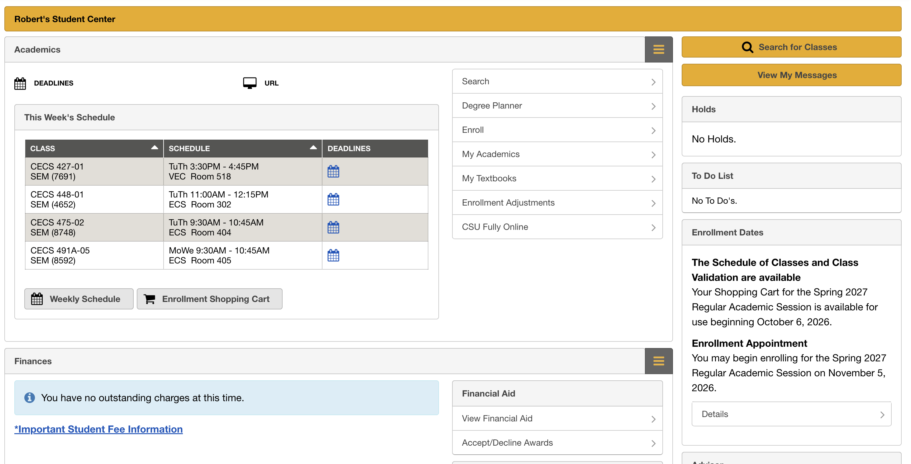

# CSULB Student Center Redesign

CECS 448 User Interface Design · Fall 2026 · Project 2: User-Centered Design

A clickable front-end prototype that redesigns the CSULB Student Center home page. It targets specific usability problems in the current page and ties each fix to a design principle from the course.

## Run it

No install or build step is needed.

1. Download or clone this repository.
2. Open `index.html` in any modern browser (Chrome, Firefox, Safari, Edge).

The only external resource is Google Fonts. Without an internet connection the page falls back to system fonts and still works.

To get a live link, turn on GitHub Pages: **Settings → Pages → Deploy from a branch → `main` / root**. The prototype will then be at `https://<username>.github.io/<repo-name>/`.

## The problem

| # | Usability issue in the original | Fix in the prototype | Principle |
|---|---|---|---|
| 1 | Two search entry points (gold "Search for Classes" button and a "Search" menu link) with no hint of how they differ | One search field in the header finds both classes and pages. Press `/` to focus it | Consistency and standards; flexibility and efficiency of use |
| 2 | Hamburger icons hide menus that repeat links already on the page | Five labeled tabs that are always visible, with the current page marked | Recognition rather than recall; signifiers |
| 3 | Full panels used to say "No Holds." and "No To Do's." | One row of status chips. A chip only turns gold when it needs action | Aesthetic and minimalist design; visibility of system status |
| 4 | The Nov 5 enrollment appointment is a paragraph at the bottom of the sidebar | Countdown plus a three-step timeline, with the next action as the primary button | Visibility of system status; match with the real world |
| 5 | Course codes only, "SEM" abbreviation, unexplained "URL" label | Course titles under each code, "Seminar" spelled out, jargon removed | Match between system and the real world |
| 6 | An identical calendar icon on every class row. You had to click each one to learn anything | The next deadline is written on each row. Expand a row for the full list | Recognition rather than recall; information scent |
| 7 | Static table sorted by course code | "In class now / Up next" card with the room and time remaining | Task priority; visibility of system status |
| 8 | Time conflicts only appear when you validate or enroll | The cart flags overlaps the moment a class is added and shows them on a mini calendar. Enroll states when it unlocks | Error prevention; help users recover from errors |
| 9 | "View My Messages" looks the same whether or not anything is new | Unread badge on the inbox icon and the Messages tab | Visibility of system status |
| 10 | One flat menu mixes planning, enrollment, and textbooks | Shortcuts grouped under Plan, Change my classes, and Money | Gestalt proximity; information architecture |
| 11 | Meeting times shown only as text | Weekly calendar with today highlighted and a current-time line | Match between system and the real world |

## Demo guide

Click **Design notes** in the header to show numbered pins on each fix. The side panel lists Before / After / Principle for each one, and clicking a note jumps to that part of the page.

The **Demo clock** at the top of the notes panel sets the time, so a live demo can show "In class now" or the enrollment day regardless of when you present.

Suggested flow for the error-prevention fix:

1. Type `450` in the search box and click **Add** on CECS 450.
2. The cart flags a time conflict with CECS 428 and highlights both on the mini calendar.
3. Click **Check my cart**. It reports that the cart isn't ready until the conflict is fixed.
4. Click **Preview Nov 5** to unlock Enroll, then click **Enroll**. Enrollment is blocked and nothing changes.
5. Remove one of the conflicting classes and enroll again. It succeeds, CECS 491B stays in the cart, and **Undo** is available.

## Data

Fall 2026 course titles, meeting times, and rooms come from the [CSULB Fall 2026 CECS Schedule of Classes](https://web.csulb.edu/depts/enrollment/registration/class_schedule/Fall_2026/By_Subject/CECS.html). Deadlines, messages, and Spring 2027 sections are sample data for demonstration. There is no backend. All state resets on reload.

## Tech

A single HTML file with inline CSS and vanilla JavaScript. No frameworks or dependencies. It supports light and dark mode, works at phone width, and is fully keyboard operable.

## Team

| Member | Role / contributions |
|---|---|
| | |
| | |
| | |
| | |
| | |
